# External Casdoor

> 中文：[外部 Casdoor](external-casdoor.zh-CN.md)

CSGHub normally ships a bundled Casdoor instance that bootstraps its own
organization, applications, JWT signing certificate and administrator. This
guide describes how to point CSGHub at a Casdoor instance that you operate
yourself (`global.casdoor.enabled: false`).

With external Casdoor the chart no longer creates any Casdoor object. You must
pre-create the objects below in your Casdoor instance and copy the resulting
credentials into the chart values.

> The chart assumes a Casdoor schema compatible with the bundled image
> (`casbin/casdoor:3.62.1`). Older releases may not expose every setting named
> here (for example the **Signin session** toggle), and CSGHub cannot be
> configured correctly against them.

## 1. Prerequisites

- A reachable Casdoor instance. HTTPS is recommended for production; plain HTTP
  works for local or internal testing. The endpoint must be reachable from both
  the browser and the CSGHub server pods, and the Casdoor `origin` setting must
  equal the URL you will configure in `global.casdoor.external.endpoint`,
  scheme included.
- Administrative access to that Casdoor instance.
- The CSGHub endpoint (`global.gateway.external.domain`, with TLS as
  configured). You need it to build redirect URIs.
- A Kubernetes Secret holding the JWT signing certificate (created in step 4).

## 2. Confirm the endpoint

```bash
curl -sS https://sso.example.com/.well-known/openid-configuration | jq -r .issuer
```

The issuer must equal `https://sso.example.com`, with no trailing slash. If it
does not, fix the Casdoor `origin` / frontend URL before continuing.

Casdoor builds the issuer and every advertised endpoint
(`authorization_endpoint`, `token_endpoint`, `userinfo_endpoint`) from `origin`.
In-cluster consumers use those endpoints, and the Temporal console validates the
ID token issuer against `global.casdoor.external.endpoint`. A `localhost` or
otherwise unreachable `origin` therefore surfaces later as a failed token
exchange.

## 3. Create the organization

In Casdoor: **Organizations → Add**.

- Name: `OpenCSG` (or your own name; set `global.casdoor.organization` accordingly)
- Password type: `bcrypt`, salt `OpenCSG`
- Account items: keep `Tag` and `Is admin` (details below)

*Default application: leave it empty for now. The dropdown only lists existing
applications, and `CSGHub` is created in step 5. The other attributes (logo,
theme, languages, password policy, ...) can be set however you need; they do not
affect the CSGHub integration.*

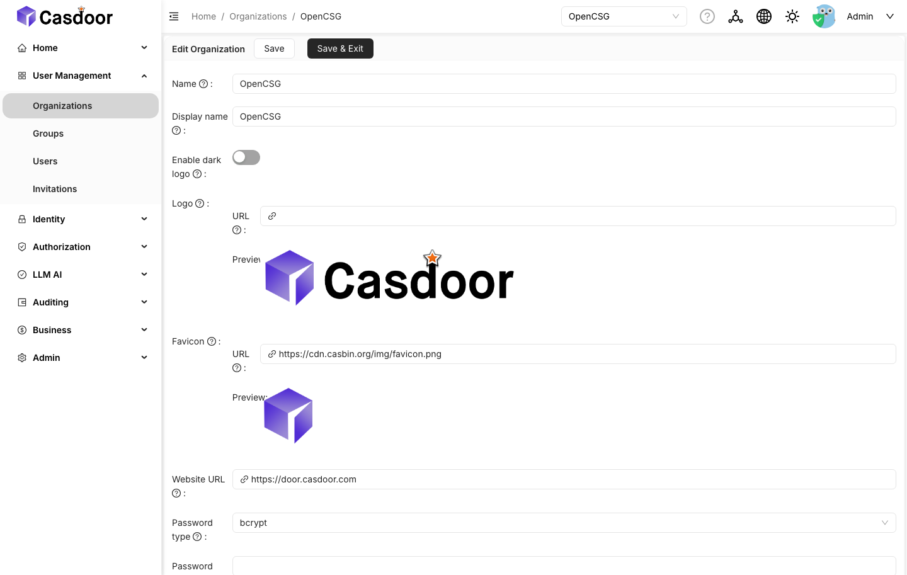

### Account items

The **Account items** table of an organization decides which user fields show up
in the signup and profile forms. CSGHub reads the user `Tag` field and the
administrator flag, so both rows have to stay in that table.

Open **Organizations → OpenCSG → Edit** and scroll down to **Account items**.

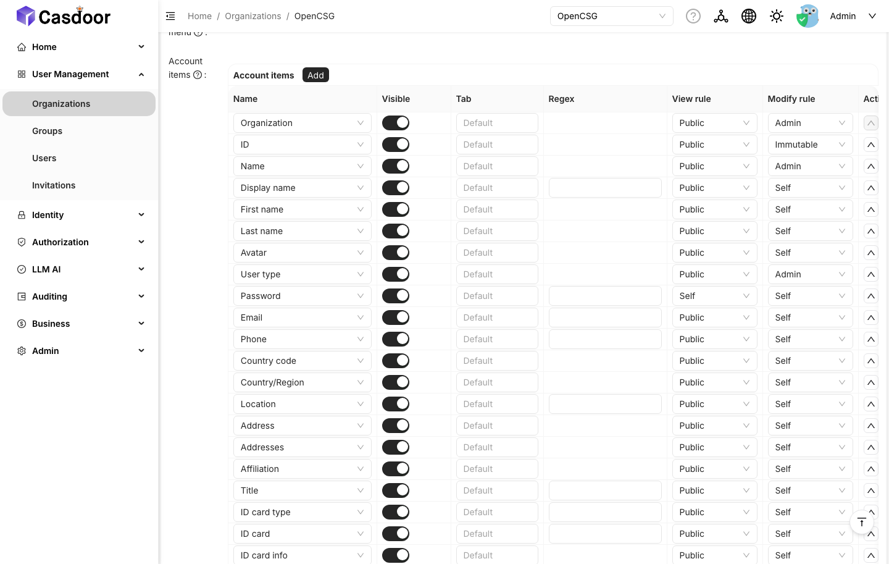

The table comes pre-filled with the default items. Look for these two rows:

| Name | Visible | View rule | Modify rule |
| --- | --- | --- | --- |
| `Tag` | on | `Public` | `Admin` |
| `Is admin` | on | `Admin` | `Admin` |

That is the Casdoor default and what the bundled deployment sets, so a new
organization already matches. When editing the table:

- The **Name** column is a dropdown of the known Casdoor items, not a free-text
  field. If a row is missing, click **Add** in the Account items card header and
  pick `Tag` / `Is admin` from that dropdown. The stored name is the English key
  even when the UI runs in another language.
- The **View rule** and **Modify rule** columns are only rendered while the row
  is visible. `Is admin` is administrative, so its modify rule is limited to
  `Admin` / `Immutable`.

Removing either row does not break the login, but the field disappears from the
CSGHub profile page.

## 4. Create the JWT signing certificate

In Casdoor: **Certs → Add**.

- Organization: `OpenCSG`
- Name: `csghub-cert`
- Scope: `JWT`
- Type: `x509`
- Algorithm: `RS256`, bit size `4096`

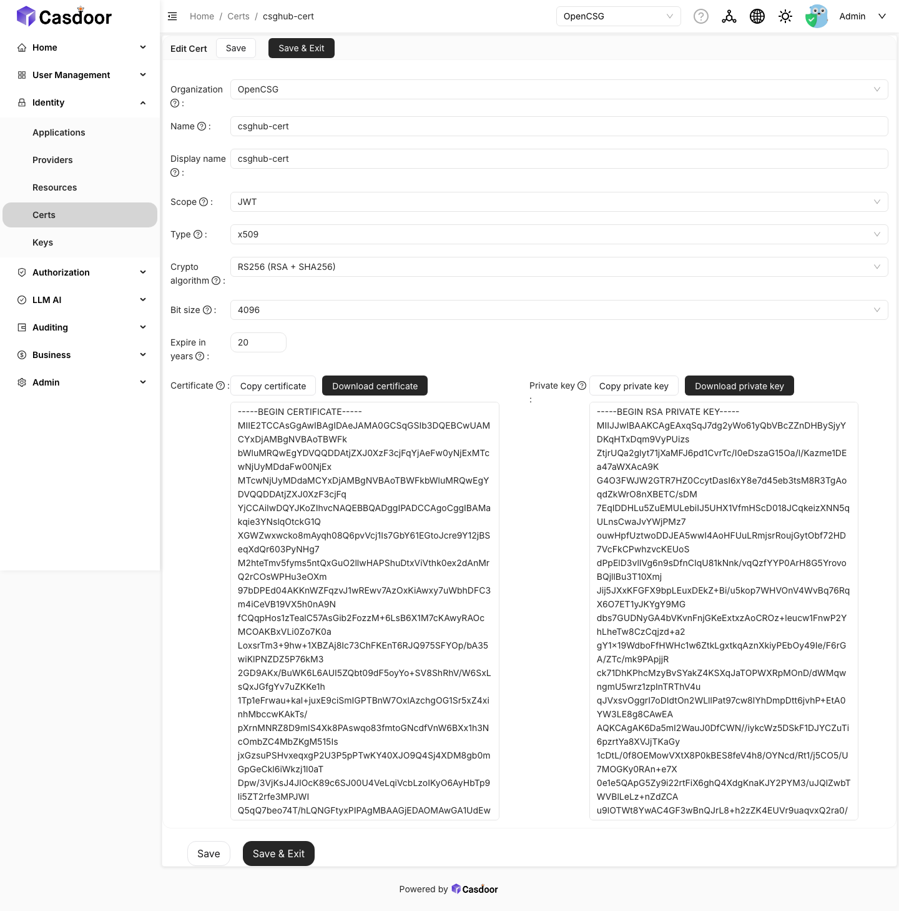

Casdoor generates the key pair. Export the **public certificate** (not the
HTTPS certificate of the Casdoor endpoint) and create the Secret:

```bash
# tls.crt must contain the PEM certificate of the csghub-cert signing key
kubectl create secret generic csghub-casdoor-cert \
  --namespace csghub \
  --from-file=tls.crt=./csghub-cert.crt
```

The chart mounts this Secret into the server, user and executor pods and points
`STARHUB_SERVER_CASDOOR_CERTIFICATE` at `tls.crt`.

## 5. Create the CSGHub application

In Casdoor: **Applications → Add**. The settings are spread over several tabs.

**Basic**

- Name: `CSGHub` (or set `global.casdoor.application`)
- Organization: `OpenCSG`
- Cert: `csghub-cert`
- Redirect URI: `<csghub-endpoint>/api/v1/callback/casdoor`


**OIDC/OAuth**

- Token format: `JWT`
- Grant types: `Authorization Code`

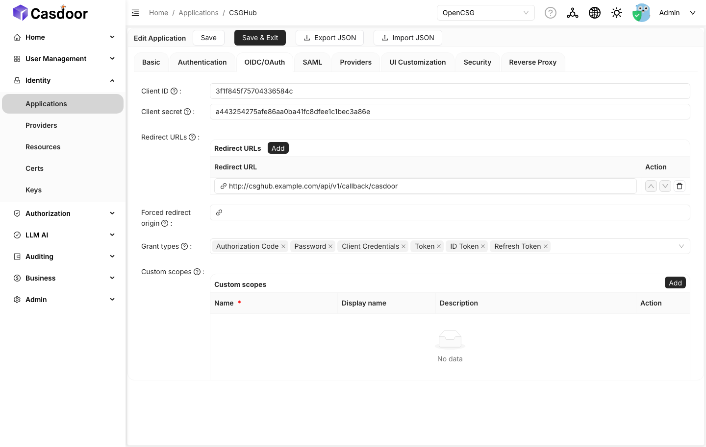

**Authentication**

- Signin session: on
- Enable signup: on

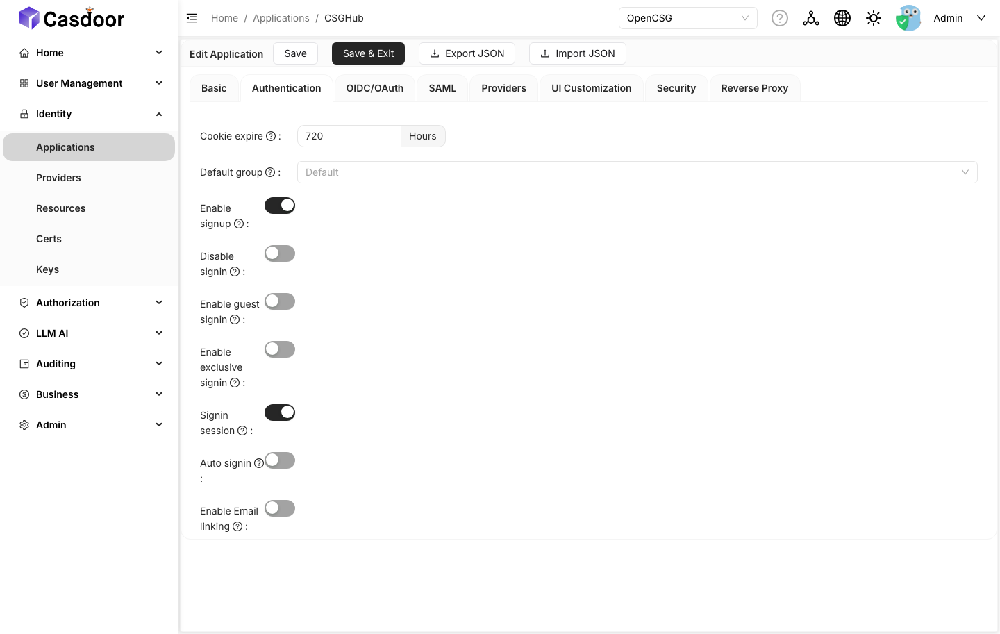

**UI Customization**

- Organization choice mode: `Select`

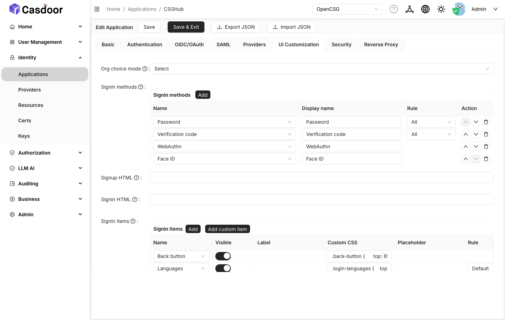

*If `csghub-cert` is not selectable while you are creating the application,
save it with the other fields first (the Organization must be set), reopen it,
and select the cert then.*

Copy the generated **Client ID** and **Client secret** from the **Basic** tab;
they become `global.casdoor.external.applications.portal.clientId` and
`clientSecret`.

Finally set **Organizations → OpenCSG → Edit → Default application** to
`CSGHub`. Step 3 leaves it empty because the application did not exist yet.

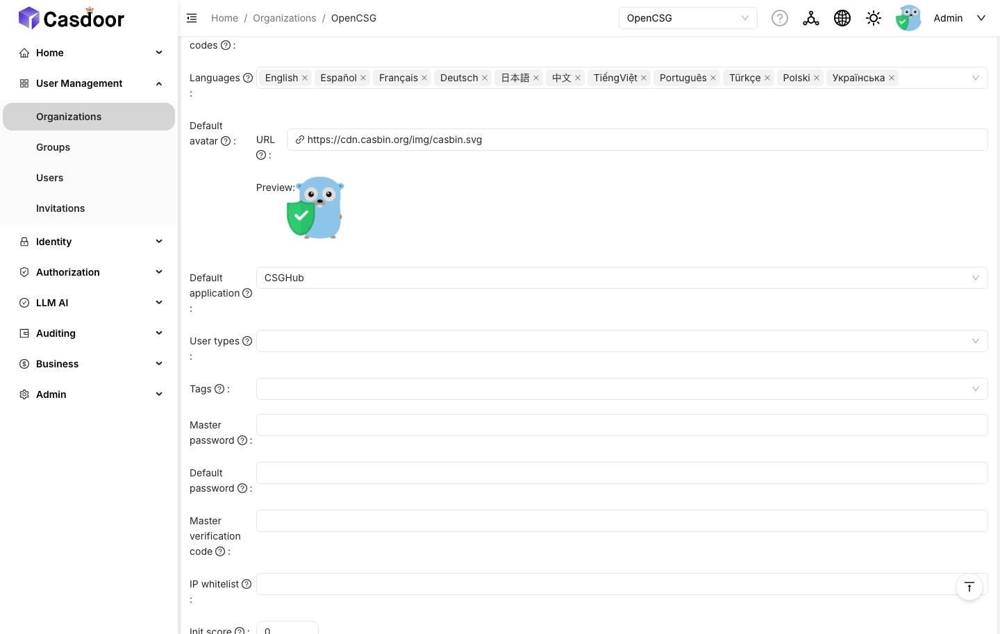

## 6. Create the Admin application

Used by the Temporal and Superset consoles when they are enabled. Same tabs as
above.

In Casdoor: **Applications → Add**.

**Basic**

- Name: `Admin`
- Organization: `OpenCSG`
- Cert: `csghub-cert`
- Redirect URIs:
  - `<csghub-endpoint>/-/temporal/auth/sso/callback`
  - `<csghub-endpoint>/-/superset/oauth-authorized/casdoor`


**OIDC/OAuth**

- Token format: `JWT`
- Grant types: `Authorization Code`

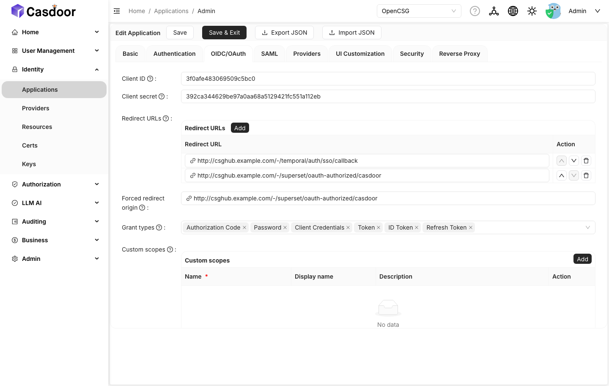

**Authentication**

- Signin session: on
- Enable signup: off

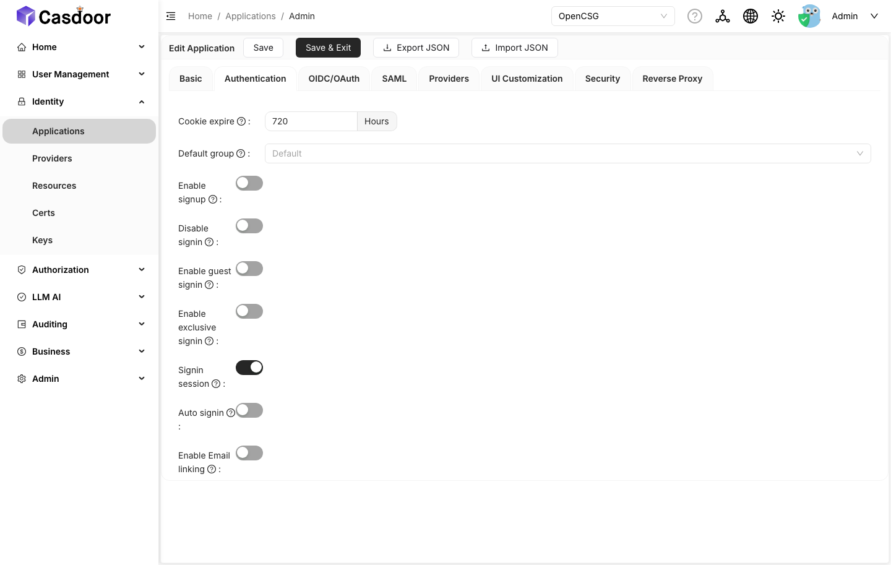

Copy its client ID and secret into
`global.casdoor.external.applications.admin.clientId` / `clientSecret`. The chart
fails at render time if Temporal console or Superset is enabled and these values
are missing.

## 7. Create the CSGShip application (optional)

Only needed when you run CSGShip against the external instance.

**Basic**

- Name: `CSGShip`
- Organization: `OpenCSG`
- Cert: `csghub-cert`
- Redirect URI: `<csgship-webAPI-endpoint>/api/v1/account/casdoor/login/callback`

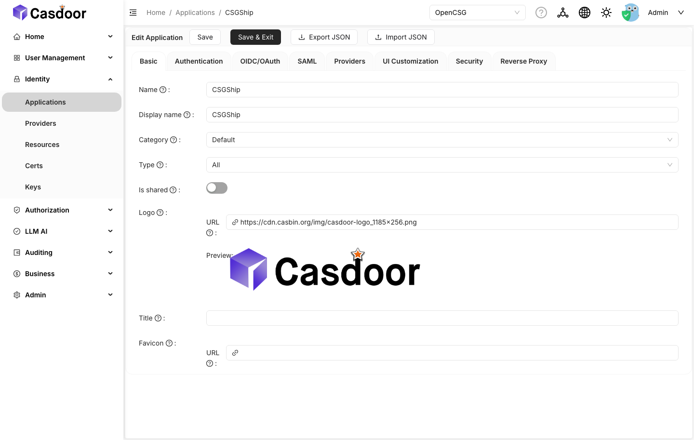

**OIDC/OAuth**

- Token format: `JWT`
- Grant types: `Authorization Code`

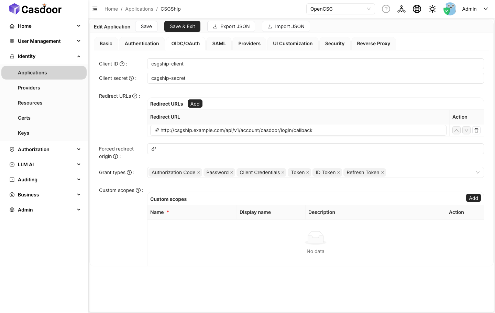

Copy the credentials into `global.casdoor.external.applications.csgship.clientId`
/ `clientSecret`.

> **CSGShip in the CSGHub umbrella:** the umbrella pulls CSGShip as a
> published subchart, and the pinned release cannot use an external Casdoor.
> The chart therefore rejects `global.casdoor.enabled=false` together with
> `csgship.enabled=true`. Keep `csgship` disabled, or run the CSGShip chart
> standalone once it ships the `global.casdoor` support.

## 8. Create the providers

Applications reference providers by name. Create the ones you need under
**Providers**:

- `Email_Provider` (category `Email`): required for signup email flows.
- `Captcha_Provider` (category `Captcha`): referenced by the default sign-in
  page.
- `GitLab_Provider` (category `OAuth`, type `Custom`): only if you use GitLab
  login.

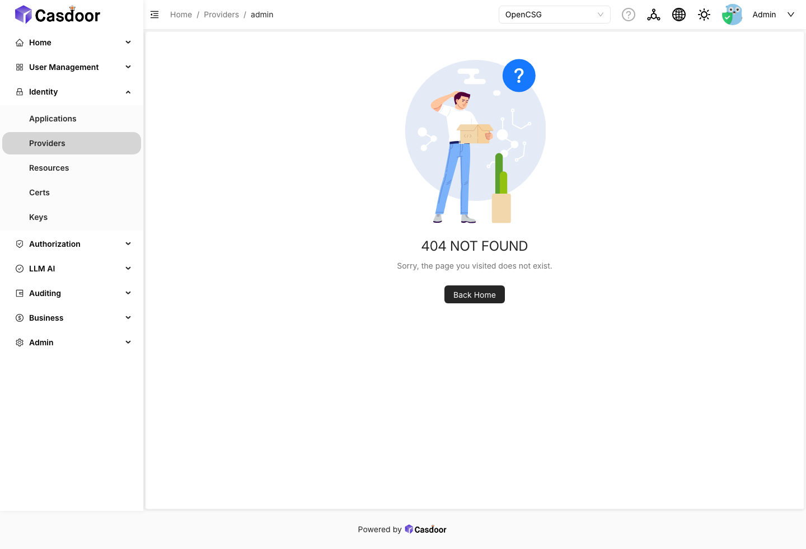

An application that references a missing provider shows an error on the sign-in
page.

## 9. Create the first administrator

The Users page creates a new user in whichever organization is selected in the
**organization selector of the top navigation**, not in an organization you pick
later. With the default `All` selected, **Users → Add** tries to create the user
in `built-in`, and Casdoor refuses it:

> adding a new user to the 'built-in' organization is currently disabled ... all
> users in the 'built-in' organization are global administrators in Casdoor

Do not enable **Has privilege consent** on `built-in` to get around this: it
makes the user a global Casdoor administrator, which CSGHub does not need.
Instead:

1. In the top navigation bar, find the organization selector on the right, next
   to the language/theme buttons and the account menu. It is a wide dropdown
   showing `All` by default; switch it to `OpenCSG`. Only an administrator sees
   this selector, and it is hidden on narrow (mobile) layouts, so widen the
   browser window if it is missing.

   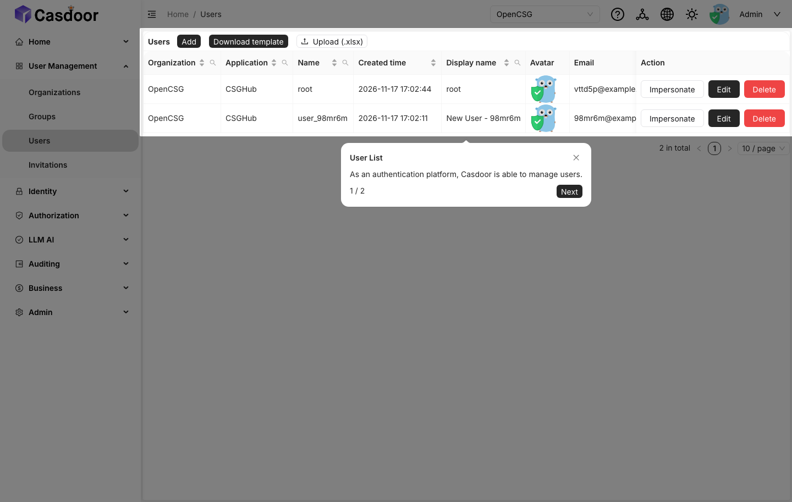

2. **Users → Add**. Casdoor creates `user_<random>` in `OpenCSG` and opens its
   edit page.

   

3. Set **Name** to `root`, set **Tag** to `is_admin`, tick **Is admin**, then
   save.

   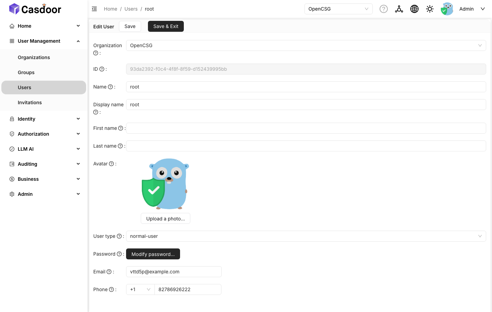

   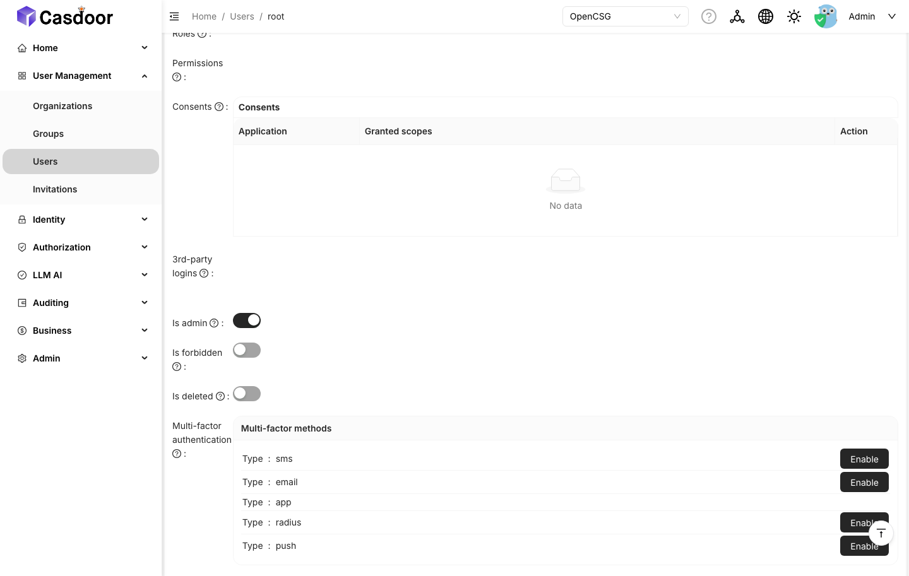

The name matters: CSGHub promotes `root` to its own administrator on first
sign-in. An administrator with a different username is not promoted
automatically.

## 10. Configure the chart

The switch, the organization/application names and the external settings all
live in `global.casdoor`, because the Casdoor instance is shared with the other
charts of the deployment:

```yaml
global:
  casdoor:
    enabled: false                # false = use the external instance
    organization: "OpenCSG"       # organization CSGHub authenticates against
    application: "CSGHub"         # application CSGHub authenticates against
    external:
      endpoint: "https://sso.example.com"
      existingSecret: "csghub-casdoor-cert"
      applications:
        portal:                   # the application the CSGHub portal logs into
          clientId: "<portal client id>"
          clientSecret: "<portal client secret>"
        admin:                    # required when Temporal console or Superset is enabled
          clientId: "<admin client id>"
          clientSecret: "<admin client secret>"
        csgship:                  # only for a standalone CSGShip deployment
          clientId: "<csgship client id>"
          clientSecret: "<csgship client secret>"
```

The keys under `applications` are roles, not Casdoor application names. The
applications of an external instance can be named anything. `portal` is the
application the CSGHub portal logs into (its name goes into
`global.casdoor.application`), `admin` the one the Temporal and Superset
consoles use, and `csgship` the CSGShip one.

`global.casdoor.external.endpoint` overrides the derived Casdoor URL everywhere
it is consumed: the server configmap, portal login URL, CORS origins, Temporal
and Superset OIDC settings, and the redirect route.

With `global.casdoor.enabled=false` the chart creates no Casdoor object at all.
The render fails when a required value is missing, so an incomplete setup is
caught at install time:

| Missing value | When it is required |
| --- | --- |
| `global.casdoor.external.endpoint` | always |
| `global.casdoor.external.existingSecret` | CSGHub chart (its server, user and executor pods mount the JWT certificate); not needed by a standalone CSGShip |
| `global.casdoor.external.applications.portal.clientId` / `clientSecret` | always |
| `global.casdoor.external.applications.admin.clientId` / `clientSecret` | Temporal console or Superset enabled |
| `global.casdoor.external.applications.csgship.clientId` / `clientSecret` | standalone CSGShip deployment |

## 11. Optional: sync the CSGHub administrator role to Casdoor

The bundled deployment keeps Casdoor `user.is_admin` in sync with CSGHub's
`role_mask` through a PostgreSQL foreign data wrapper. With external Casdoor
this is **not** configured automatically: the chart skips the sync script, and
you must run it yourself if you want the behaviour.

The external Casdoor database must:

1. Be reachable from the bundled PostgreSQL instance.
2. Have a role `csghub_server_fdw` with `CONNECT`, `USAGE` on schema `public`,
   and `SELECT, UPDATE` on `public."user"`.

`docs/external-casdoor/fdw-grant.sql` contains the grants to run on the external
Casdoor database. Then create the foreign server/trigger in the CSGHub server
database, replacing the host, port and database name with your Casdoor values:

```sql
CREATE EXTENSION IF NOT EXISTS postgres_fdw;

CREATE SERVER csghub_casdoor_fdw FOREIGN DATA WRAPPER postgres_fdw
  OPTIONS (host '<casdoor-db-host>', port '5432', dbname 'csghub_casdoor');

CREATE USER MAPPING FOR <csghub-server-db-user>
  SERVER csghub_casdoor_fdw OPTIONS (user 'csghub_server_fdw');

CREATE FOREIGN TABLE public.casdoor_users (id varchar(100), is_admin boolean)
  SERVER csghub_casdoor_fdw OPTIONS (schema_name 'public', table_name 'user');
```

The trigger function and trigger are identical to
`charts/csghub/scripts/server/1789619535_sync_role_mask_admin.sql`; apply the
remainder of that file after the statements above.

If you skip this step CSGHub keeps working, but toggling administrator in CSGHub
will not change Casdoor, so those users cannot open the Temporal or Superset
consoles.

## 12. Install and verify

```bash
helm upgrade --install csghub charts/csghub -n csghub -f values.yaml
```

Check, in order:

1. **Endpoint**: `kubectl -n csghub get configmap <release>-core -o yaml | grep CASDOOR`
   shows your endpoint, organization, application and client ID.
2. **Certificate**: the server pod mounts `tls.crt` and its content is the
   `csghub-cert` public certificate.
3. **Login**: open the CSGHub UI, sign in, and confirm the browser returns to
   `/api/v1/callback/casdoor` without an error.
4. **Token validation**: server logs show no `401` / certificate errors after
   login.
5. **Optional modules**: open the Temporal console (if enabled) and confirm SSO
   signs in without prompting on every visit.

`docs/external-casdoor/verify.sh` runs the read-only checks above against a
running release.

## Troubleshooting

| Symptom | Likely cause |
| --- | --- |
| Redirected to Casdoor, then back to the login page | `tls.crt` is the HTTPS certificate instead of the `csghub-cert` JWT certificate, or the client ID/secret do not match the application. |
| `invalid redirect_uri` from Casdoor | Redirect URI does not exactly match scheme/host/port of the CSGHub endpoint. |
| `invalid_client` | Client ID or secret copied from a different application. |
| Temporal SSO fails while exchanging the token, and the URL points at a host you did not configure | Casdoor `origin` differs from `global.casdoor.external.endpoint`, or `origin` was changed after the Temporal console started. Align `origin`, then restart the Temporal deployment. |
| Login works, but every Temporal console visit asks for credentials | The **Signin session** toggle (Authentication tab) is off on the `CSGHub`/`Admin` application. |
| Administrator changes in CSGHub do not reach Casdoor | FDW sync not configured (step 11). |
| `x509: certificate signed by unknown authority` in server logs | The Casdoor endpoint uses a private CA that the server container does not trust. Use a publicly trusted certificate, or mount the CA and set `SSL_CERT_FILE` through the server service `volumes`/`environments` overrides. |
| Sign-in page shows a provider error | The application references a provider that does not exist (step 8). |
| Install fails with `global.casdoor.enabled=false cannot be combined with csgship.enabled=true` | The CSGShip subchart of the umbrella cannot use an external Casdoor yet (step 7). Keep `csgship` disabled. |
