# 外部 Casdoor

> English: [External Casdoor](external-casdoor.md)

CSGHub 默认自带一个 Casdoor 实例，会自己初始化组织、应用、JWT 签名证书和管理员。
本文说明如何让 CSGHub 使用你自己运维的 Casdoor 实例
（`global.casdoor.enabled: false`）。

使用外部 Casdoor 时，chart 不再创建任何 Casdoor 对象。你需要在 Casdoor 里预先创建
下面这些对象，再把生成的凭据填进 chart values。

> chart 假定 Casdoor 的 schema 与内置镜像（`casbin/casdoor:3.62.1`）兼容。更老的版本
> 可能没有这里提到的某些配置项（例如 **Signin session** 开关），无法正确对接 CSGHub。

## 1. 前置条件

- 一个可访问的 Casdoor 实例。生产环境建议用 HTTPS；本地或内网测试直接用 HTTP 也
  可以。endpoint 必须同时能从浏览器和 CSGHub 的 server Pod 访问，且 Casdoor 的
  `origin` 配置必须等于你准备填到 `global.casdoor.external.endpoint` 的 URL，
  scheme 也要一致。
- 该 Casdoor 实例的管理员权限。
- CSGHub 的访问地址（`global.gateway.external.domain`，TLS 按实际配置）。用来拼
  redirect URI。
- 一个保存 JWT 签名证书的 Kubernetes Secret（第 4 步创建）。

## 2. 确认 endpoint

```bash
curl -sS https://sso.example.com/.well-known/openid-configuration | jq -r .issuer
```

issuer 必须等于 `https://sso.example.com`，结尾不要带斜杠。如果不一致，先修正
Casdoor 的 `origin` / 前端地址再继续。

Casdoor 用 `origin` 生成 issuer 和 discovery 里的所有 endpoint
（`authorization_endpoint`、`token_endpoint`、`userinfo_endpoint`）。集群内的组件
用的就是这些 endpoint，Temporal 控制台还会用 `global.casdoor.external.endpoint`
校验 ID token 的 issuer。所以 `origin` 配成 `localhost` 或其它集群内访问不到的
地址，最后都会在换 token 时失败。

## 3. 创建组织

Casdoor：**Organizations → Add**。

- Name：`OpenCSG`（也可以用你自己的名字，相应修改 `global.casdoor.organization`）
- Password type：`bcrypt`，salt `OpenCSG`
- Account items：保留 `Tag` 和 `Is admin`（详见下节）

*Default application：先留空，下拉框只列出已存在的应用，`CSGHub` 要到第 5 步才
创建。其余属性（logo、主题、语言、密码策略等）按需设置即可，不影响 CSGHub 对接。*

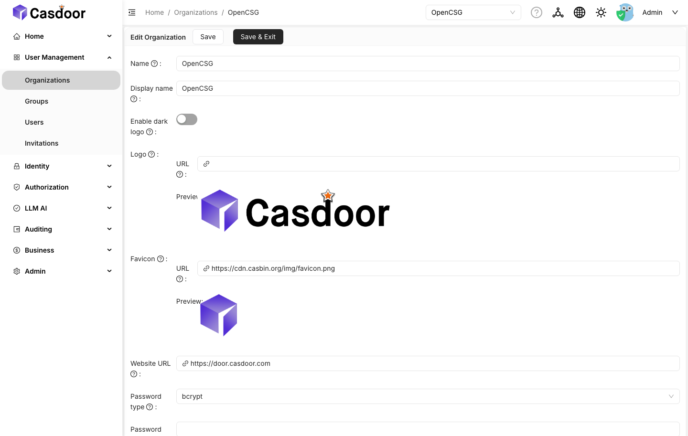

### Account items

组织的 **Account items** 表决定注册和个人资料页里显示哪些用户字段。CSGHub 会读
用户的 `Tag` 字段和管理员标记，所以这两行必须留在表里。

打开 **Organizations → OpenCSG → Edit**，往下滚到 **Account items**。

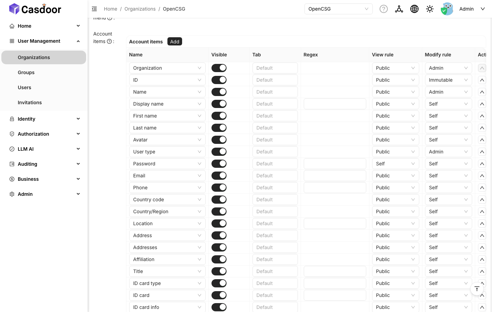

表格默认已经填好一整套条目，找到这两行：

| Name | Visible | View rule | Modify rule |
| --- | --- | --- | --- |
| `Tag` | 开 | `Public` | `Admin` |
| `Is admin` | 开 | `Admin` | `Admin` |

这就是 Casdoor 的默认值，也是内置部署的配置，新建组织不用改。编辑表格时注意：

- **Name** 列是已知条目的下拉框，不能随便输入。行被删掉时，点 Account items 卡片
  标题栏的 **Add**，从下拉框里选 `Tag` / `Is admin`，存下来的是英文 key，界面切成
  别的语言也不影响。
- **View rule** / **Modify rule** 两列只有在 Visible 打开时才显示。`Is admin` 属于
  管理项，它的 Modify rule 只有 `Admin` / `Immutable` 可选。

删掉任意一行不影响登录，但该字段会从 CSGHub 个人资料页里消失。

## 4. 创建 JWT 签名证书

Casdoor：**Certs → Add**。

- Organization：`OpenCSG`
- Name：`csghub-cert`
- Scope：`JWT`
- Type：`x509`
- Algorithm：`RS256`，bit size `4096`

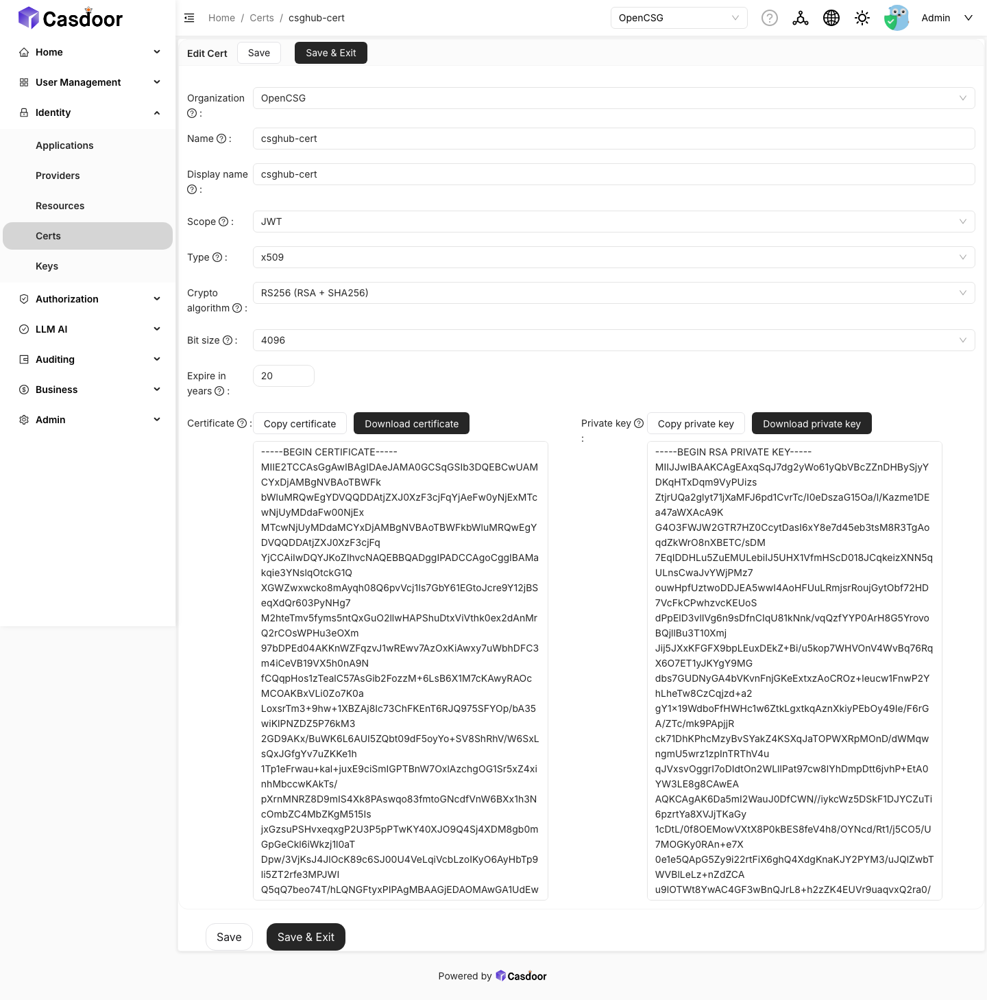

Casdoor 会生成密钥对。导出**公钥证书**（不是 Casdoor endpoint 的 HTTPS 证书），
创建 Secret：

```bash
# tls.crt 必须是 csghub-cert 签名密钥对应的 PEM 公钥证书
kubectl create secret generic csghub-casdoor-cert \
  --namespace csghub \
  --from-file=tls.crt=./csghub-cert.crt
```

chart 会把该 Secret 挂载到 server、user、executor 三个 Pod，并把
`STARHUB_SERVER_CASDOOR_CERTIFICATE` 指向 `tls.crt`。

## 5. 创建 CSGHub 应用

Casdoor：**Applications → Add**。这些字段分散在几个 tab 里。

**Basic**

- Name：`CSGHub`（或修改 `global.casdoor.application`）
- Organization：`OpenCSG`
- Cert：`csghub-cert`
- Redirect URI：`<csghub-endpoint>/api/v1/callback/casdoor`


**OIDC/OAuth**

- Token format：`JWT`
- Grant types：`Authorization Code`

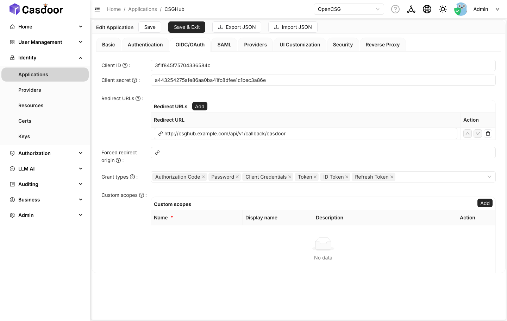

**Authentication**

- Signin session：开启
- Enable signup：开启

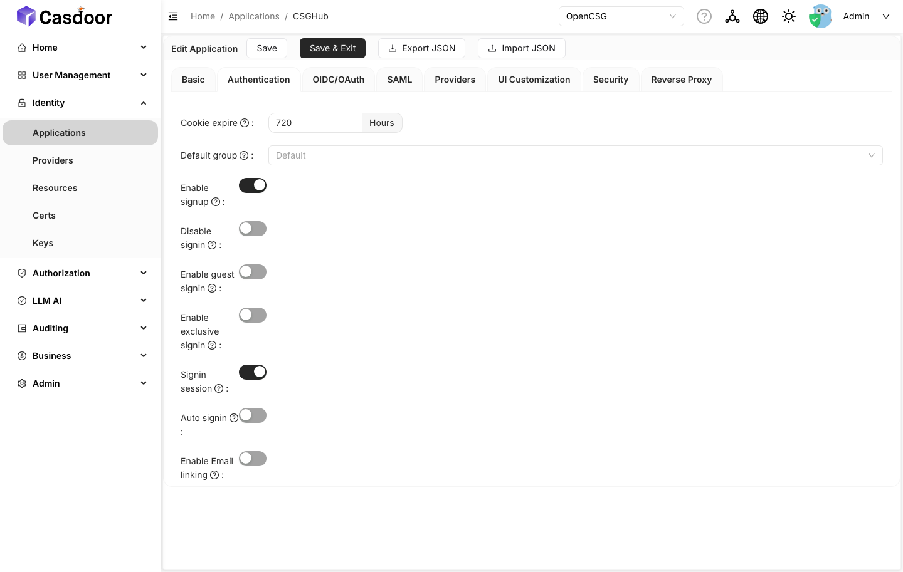

**UI Customization**

- Organization choice mode：`Select`

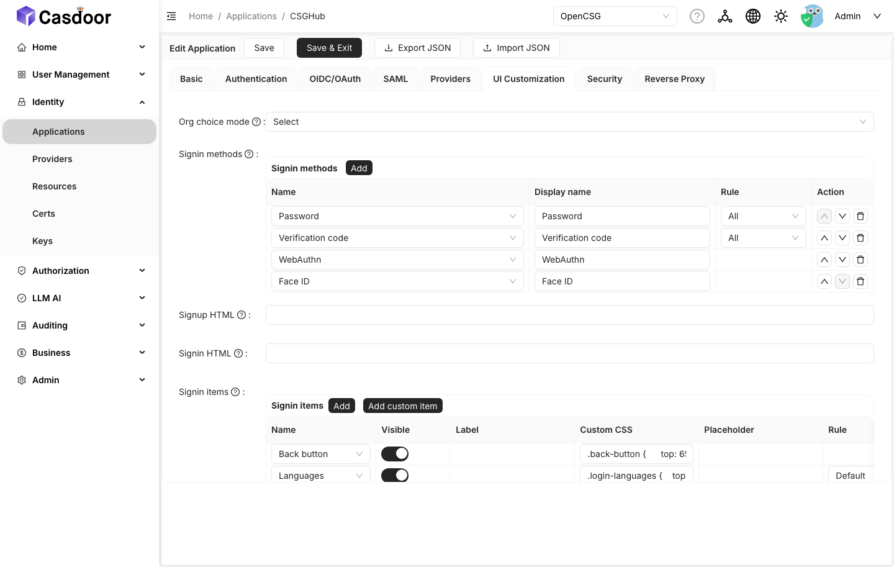

*如果创建应用时 Cert 下拉框里选不到 `csghub-cert`，先把其它字段（Organization 必须
填）保存，重新打开应用再选证书。*

复制 **Basic** tab 里生成的 **Client ID** 和 **Client secret**，分别填到
`global.casdoor.external.applications.portal.clientId` / `clientSecret`。

最后把 **Organizations → OpenCSG → Edit → Default application** 设为 `CSGHub`。
第 3 步留空是因为那时这个应用还不存在。

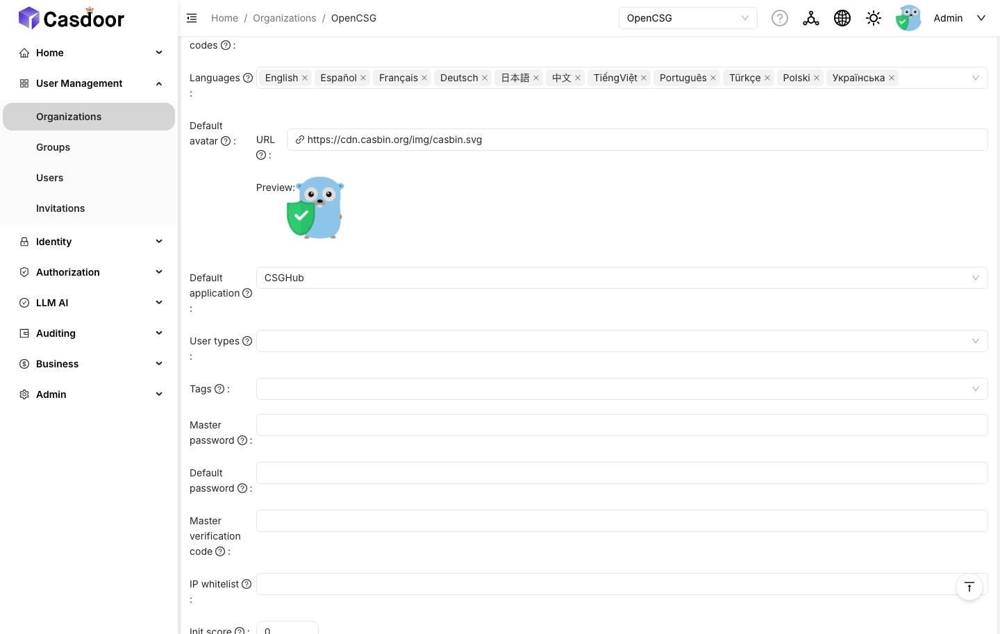

## 6. 创建 Admin 应用

Temporal 和 Superset 控制台启用时会用到。tab 划分跟上面一样。

Casdoor：**Applications → Add**。

**Basic**

- Name：`Admin`
- Organization：`OpenCSG`
- Cert：`csghub-cert`
- Redirect URIs：
  - `<csghub-endpoint>/-/temporal/auth/sso/callback`
  - `<csghub-endpoint>/-/superset/oauth-authorized/casdoor`


**OIDC/OAuth**

- Token format：`JWT`
- Grant types：`Authorization Code`

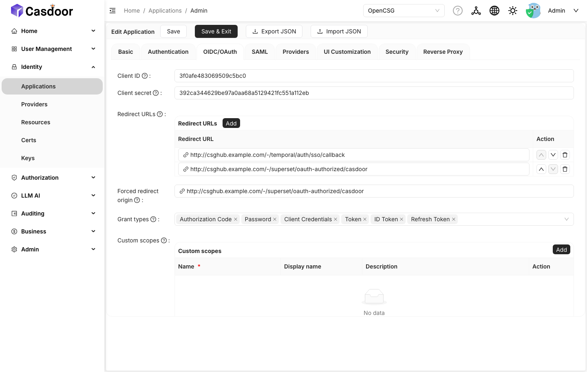

**Authentication**

- Signin session：开启
- Enable signup：关闭

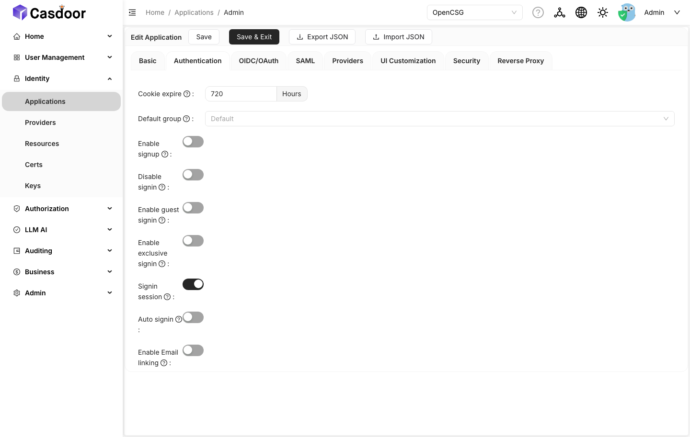

把它的 client ID 和 secret 填到
`global.casdoor.external.applications.admin.clientId` / `clientSecret`。如果启用了
Temporal 控制台或 Superset 但没填这两个值，chart 会在渲染阶段直接失败。

## 7. 创建 CSGShip 应用（可选）

只有让 CSGShip 对接这个外部实例时才需要。

**Basic**

- Name：`CSGShip`
- Organization：`OpenCSG`
- Cert：`csghub-cert`
- Redirect URI：`<csgship-webAPI-endpoint>/api/v1/account/casdoor/login/callback`

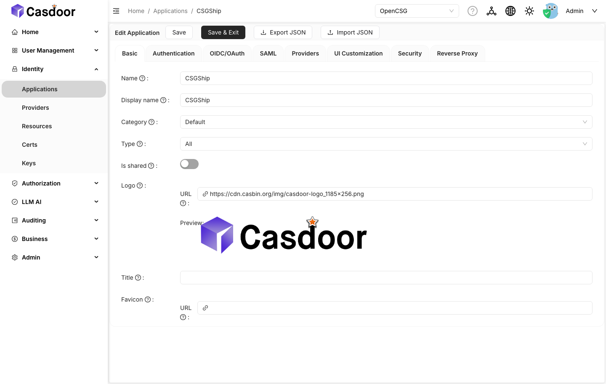

**OIDC/OAuth**

- Token format：`JWT`
- Grant types：`Authorization Code`

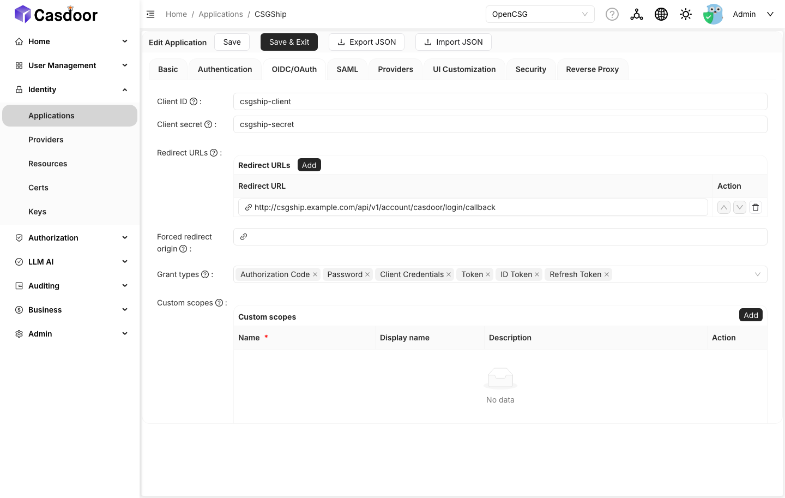

把凭据填到 `global.casdoor.external.applications.csgship.clientId` /
`clientSecret`。

> **CSGHub umbrella 里的 CSGShip**：umbrella 把 CSGShip 作为已发布的子 chart
> 引入，当前 pin 的版本还不支持外部 Casdoor。因此 chart 会拒绝
> `global.casdoor.enabled=false` 与 `csgship.enabled=true` 同时出现。请保持
> `csgship` 关闭，或等 CSGShip chart 发布 `global.casdoor` 支持后再单独部署。

## 8. 创建 provider

应用按名字引用 provider。在 **Providers** 下创建你需要的：

- `Email_Provider`（category `Email`）：注册邮件的流程需要。
- `Captcha_Provider`（category `Captcha`）：默认登录页会引用。
- `GitLab_Provider`（category `OAuth`，type `Custom`）：只有用 GitLab 登录时才需要。

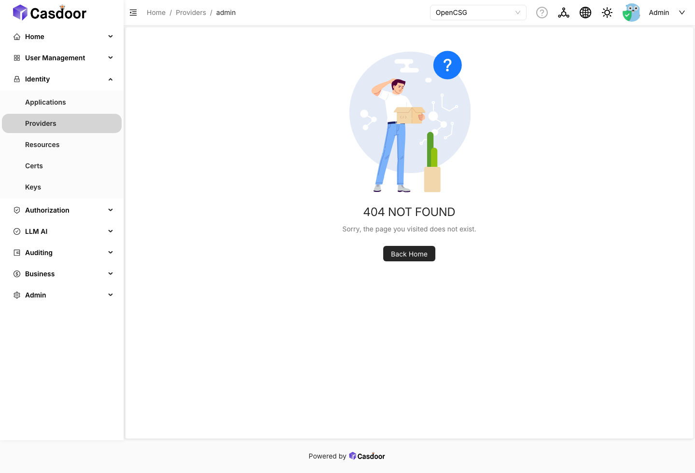

应用引用了不存在的 provider 时，登录页会报错。

## 9. 创建第一个管理员

Users 页面把新用户建在**顶部组织选择器**当前选中的组织里，不是建在你后面选的组织的。
默认选的是 `All`，这时点 **Users → Add** 会往 `built-in` 里建用户，Casdoor 直接拒绝：

> adding a new user to the 'built-in' organization is currently disabled ... all
> users in the 'built-in' organization are global administrators in Casdoor

别去给 `built-in` 打开 **Has privilege consent** 绕过：那会把用户变成 Casdoor 的
全局管理员，不是 CSGHub 要的。正确做法：

1. 顶部导航栏右侧、语言/主题按钮和账号菜单旁边，有一个组织下拉框（默认显示 `All`），
   切到 `OpenCSG`。只有管理员能看到这个下拉框；窗口太窄（移动端布局）时它也会隐藏，
   看不到就把浏览器拉宽。

   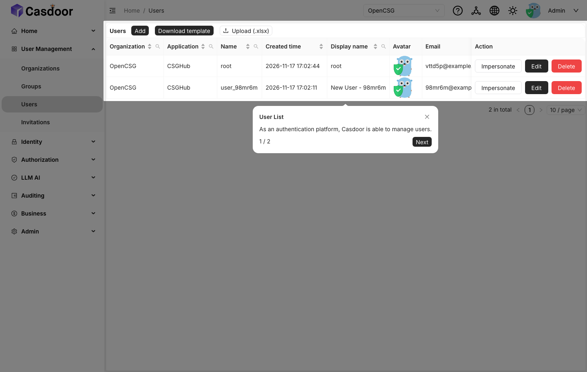

2. **Users → Add**。Casdoor 会在 `OpenCSG` 里建一个 `user_<随机串>`，并打开它的编辑页。

   

3. 把 **Name** 改成 `root`，**Tag** 填 `is_admin`，勾上 **Is admin**，保存。

   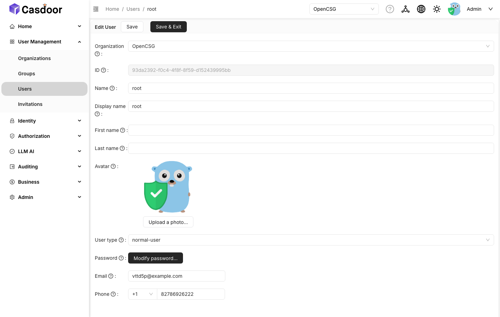

   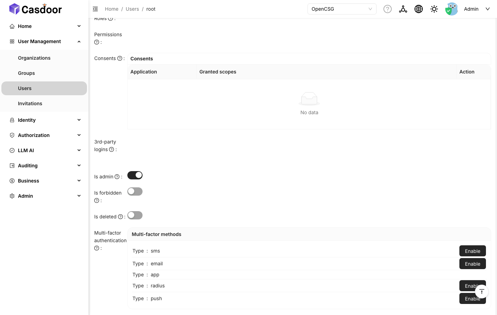

名字很重要：CSGHub 会在 `root` 首次登录时把它提升为自己的管理员。其他用户名的
管理员不会被自动提升。

## 10. 配置 chart

开关、组织/应用名和外部配置都放在 `global.casdoor`，因为 Casdoor 实例是和部署里
其他 chart 共用的：

```yaml
global:
  casdoor:
    enabled: false                # false = 使用外部实例
    organization: "OpenCSG"       # CSGHub 认证使用的组织
    application: "CSGHub"         # CSGHub 认证使用的应用
    external:
      endpoint: "https://sso.example.com"
      existingSecret: "csghub-casdoor-cert"
      applications:
        portal:                   # CSGHub 门户登录用的应用
          clientId: "<portal client id>"
          clientSecret: "<portal client secret>"
        admin:                    # 启用 Temporal 控制台或 Superset 时必填
          clientId: "<admin client id>"
          clientSecret: "<admin client secret>"
        csgship:                  # 仅独立部署 CSGShip 时需要
          clientId: "<csgship client id>"
          clientSecret: "<csgship client secret>"
```

`applications` 下的键是用途（role），不是 Casdoor 应用名，外部实例里的应用叫什么
都行。`portal` 是 CSGHub 门户登录的应用（名字填到 `global.casdoor.application`），
`admin` 是 Temporal 和 Superset 控制台用的，`csgship` 是 CSGShip 用的。

`global.casdoor.external.endpoint` 会覆盖所有用到 Casdoor URL 的地方：server
configmap、门户登录 URL、CORS、Temporal 和 Superset 的 OIDC 配置，以及重定向路由。

`global.casdoor.enabled=false` 时 chart 不会创建任何 Casdoor 对象。必填值缺失时渲染
直接失败，配置不完整在安装阶段就能发现：

| 缺失的值 | 何时必填 |
| --- | --- |
| `global.casdoor.external.endpoint` | 始终 |
| `global.casdoor.external.existingSecret` | CSGHub chart（server、user、executor 要挂 JWT 证书）；独立 CSGShip 不需要 |
| `global.casdoor.external.applications.portal.clientId` / `clientSecret` | 始终 |
| `global.casdoor.external.applications.admin.clientId` / `clientSecret` | 启用 Temporal 控制台或 Superset 时 |
| `global.casdoor.external.applications.csgship.clientId` / `clientSecret` | 独立部署 CSGShip 时 |

## 11. 可选：把 CSGHub 管理员角色同步到 Casdoor

内置部署通过 PostgreSQL 外部数据包装器（FDW）让 Casdoor 的 `user.is_admin` 与
CSGHub 的 `role_mask` 保持一致。使用外部 Casdoor 时**不会**自动配置：chart 会跳过
同步脚本，需要你自己执行。

外部 Casdoor 数据库必须：

1. 能被内置 PostgreSQL 访问。
2. 有一个角色 `csghub_server_fdw`，具备 `CONNECT`、schema `public` 的 `USAGE`，以及
   `public."user"` 的 `SELECT, UPDATE`。

`docs/external-casdoor/fdw-grant.sql` 是在外部 Casdoor 数据库上执行的授权脚本。
然后在 CSGHub server 数据库里创建 foreign server / trigger，把 host、port 和库名
换成你的 Casdoor 值：

```sql
CREATE EXTENSION IF NOT EXISTS postgres_fdw;

CREATE SERVER csghub_casdoor_fdw FOREIGN DATA WRAPPER postgres_fdw
  OPTIONS (host '<casdoor-db-host>', port '5432', dbname 'csghub_casdoor');

CREATE USER MAPPING FOR <csghub-server-db-user>
  SERVER csghub_casdoor_fdw OPTIONS (user 'csghub_server_fdw');

CREATE FOREIGN TABLE public.casdoor_users (id varchar(100), is_admin boolean)
  SERVER csghub_casdoor_fdw OPTIONS (schema_name 'public', table_name 'user');
```

触发器函数和触发器跟
`charts/csghub/scripts/server/1789619535_sync_role_mask_admin.sql` 完全一致；执行完
上面的语句后，把该文件剩余部分也执行掉。

跳过这一步 CSGHub 仍能正常工作，但在 CSGHub 里切换管理员不会同步到 Casdoor，这些
用户就打不开 Temporal 或 Superset 控制台。

## 12. 安装并验证

```bash
helm upgrade --install csghub charts/csghub -n csghub -f values.yaml
```

按顺序检查：

1. **Endpoint**：`kubectl -n csghub get configmap <release>-core -o yaml | grep CASDOOR`
   能看到你配置的 endpoint、组织、应用和 client ID。
2. **证书**：server Pod 挂载了 `tls.crt`，内容是 `csghub-cert` 的公钥证书。
3. **登录**：打开 CSGHub 界面登录，确认浏览器回到 `/api/v1/callback/casdoor`
   且没有报错。
4. **Token 校验**：登录后 server 日志里没有 `401` / 证书错误。
5. **可选模块**：打开 Temporal 控制台（如果启用），确认 SSO 能登录，且不会每次访问
   都要求重新认证。

`docs/external-casdoor/verify.sh` 会对运行中的 release 执行上面这些只读检查。

## 排障

| 现象 | 可能原因 |
| --- | --- |
| 跳转到 Casdoor 后又回到登录页 | `tls.crt` 放的是 HTTPS 证书而不是 `csghub-cert` 的 JWT 证书；或 client ID / secret 与应用不匹配。 |
| Casdoor 返回 `invalid redirect_uri` | redirect URI 与 CSGHub 访问地址的 scheme / host / port 不完全一致。 |
| `invalid_client` | client ID 或 secret 是从别的应用复制的。 |
| Temporal SSO 换 token 失败，报错里的地址不是自己配的 | Casdoor 的 `origin` 和 `global.casdoor.external.endpoint` 不一致，或者改了 `origin` 之后没重启 Temporal 控制台。对齐 `origin` 后重启 Temporal Deployment。 |
| 能登录，但每次进 Temporal 控制台都要重新认证 | `CSGHub` / `Admin` 应用的 **Signin session**（Authentication tab）没开。 |
| CSGHub 里改管理员，Casdoor 没变化 | 没配置 FDW 同步（第 11 步）。 |
| server 日志出现 `x509: certificate signed by unknown authority` | Casdoor endpoint 用的是私有 CA，server 容器不信任。换成公共信任的证书，或通过 server 服务的 `volumes` / `environments` 覆盖挂载 CA 并设置 `SSL_CERT_FILE`。 |
| 登录页显示 provider 错误 | 应用引用了不存在的 provider（第 8 步）。 |
| 安装报 `global.casdoor.enabled=false cannot be combined with csgship.enabled=true` | umbrella 里的 CSGShip 子 chart 还不支持外部 Casdoor（第 7 步）。保持 `csgship` 关闭。 |
